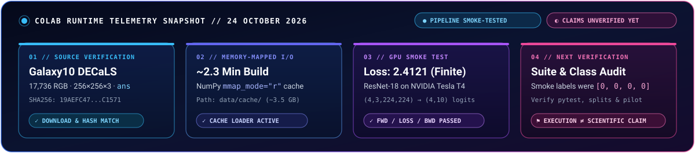
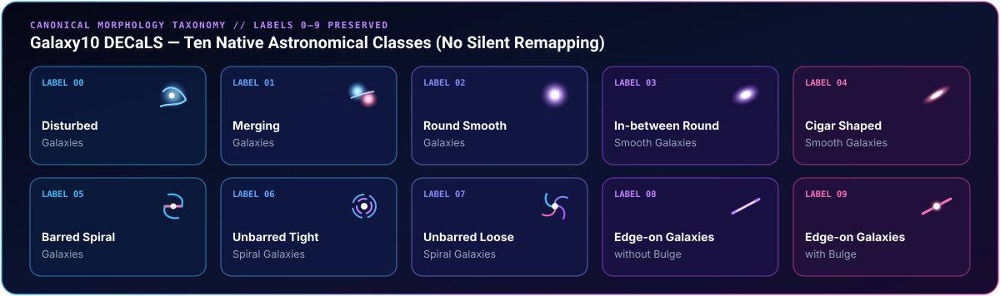
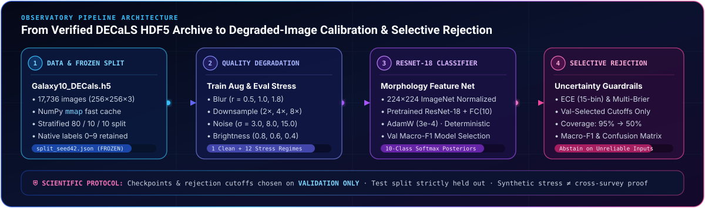
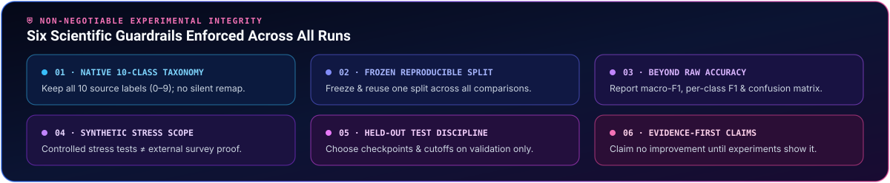
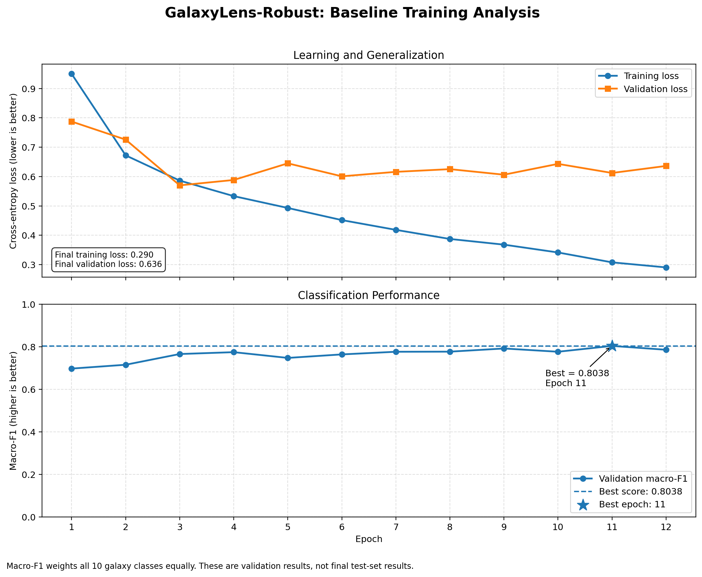

<div align="center">



<br />

<!-- ASTRO PALETTE BADGE CONSTELLATION (DARK BLUE · ELECTRIC BLUE · COSMIC PURPLE · SUPERNOVA PINK) -->
<p>
  <a href="https://www.python.org/">
    
  </a>
  <a href="https://pytorch.org/">
    
  </a>
  <a href="https://zenodo.org/records/10845026">
    
  </a>
  <a href="notebooks/GalaxyLens_Robust_Colab.ipynb">
    
  </a>
  <a href="data/splits/split_seed42.json">
    
  </a>
</p>

# GalaxyLens-Robust

**A reproducible study of how image-quality changes affect galaxy morphology classification and whether quality augmentation plus uncertainty-based rejection improve reliability.**

<p>
  <a href="#current-verified-status--24-october-2026"><code>✦ Verified Status</code></a> •
  <a href="#research-question"><code>◈ Research Question</code></a> •
  <a href="#dataset"><code>🔭 Galaxy10 Dataset</code></a> •
  <a href="#google-colab-recovery--setup"><code>⚡ Colab Setup</code></a> •
  <a href="#first-run-commands"><code>⌘ First-Run CLI</code></a> •
  <a href="#scientific-guardrails"><code>⛨ Guardrails</code></a> •
  <a href="#brightness-robustness-correction--2026-10-27"><code>☾ Brightness Correction</code></a>
</p>

</div>


## Current verified status — 24 October 2026

<p align="center">
  
</p>

> [!NOTE]
> **Verified in the user's Google Colab runtime:** the official Galaxy10 DECaLS HDF5 dataset downloaded successfully; its SHA-256 matched the expected value `19AEFC477C41BB7F77FF07599A6B82A038DC042F889A111B0D4D98BB755C1571`; the source contains 17,736 RGB images of shape 256×256×3 and labels in `ans`; a NumPy memory-mapped cache was built in about 2.3 minutes; a cache-backed loader was installed; and a ResNet-18 forward/loss/backward smoke test passed on an NVIDIA Tesla T4 with four real images. The observed smoke-test loss was 2.4121. This validates basic pipeline execution only, not accuracy or scientific claims.

> [!WARNING]
> **Not yet verified:** complete project test suite after the cache-loader change, split manifest/class distribution, a training pilot, full baseline training, robustness experiments, calibration, selective prediction, or any performance improvement. Four smoke-test labels happened to be `[0, 0, 0, 0]`; validate class distribution before training.


## Research question

<p align="center">
  
</p>

How does image quality affect galaxy-classifier predictions, and can training with realistic image-quality variation plus uncertainty-based rejection reduce unreliable classifications?


## Dataset

<p align="center">
  
</p>

Official Galaxy10 DECaLS HDF5 release: https://zenodo.org/records/10845026. Expected file `data/raw/Galaxy10_DECals.h5`; expected SHA-256 is recorded above. Keep the original ten labels (0–9). Do not silently remap labels.

| Parameter | Specification |
| :--- | :--- |
| **Official Release** | [Zenodo Record `10845026` — Galaxy10 DECaLS](https://zenodo.org/records/10845026) |
| **Canonical File Path** | `data/raw/Galaxy10_DECals.h5` |
| **Expected SHA-256** | `19AEFC477C41BB7F77FF07599A6B82A038DC042F889A111B0D4D98BB755C1571` |
| **Volume & Tensor Schema** | `17,736` RGB galaxy cutouts · `256×256×3` (`uint8`) · target array `ans` |
| **Label Taxonomy** | Original ten morphological classes (`0–9`) strictly retained ([`src/galaxylens/labels.py`](src/galaxylens/labels.py)) |
| **Fast I/O Cache** | Memory-mapped NumPy arrays under `data/cache/` (`~3.5 GB`, built via [`scripts/build_cache.py`](scripts/build_cache.py)) |


## Google Colab recovery / setup

<p align="center">
  
</p>

1. Upload/extract this ZIP to Colab. The project root should be the extracted `galaxylens` directory.
2. Download the dataset into `data/raw/Galaxy10_DECals.h5` (use resumable `wget -c` if needed).
3. From the project root, run `python scripts/build_cache.py`. The cache is placed at `data/cache/` and is not included in this ZIP because it is about 3.5 GB.
4. Run `pip install -e .` and `pytest -q`.
5. Create/verify the frozen split manifest using `python scripts/create_splits.py` and inspect class counts before training. Do not overwrite an existing agreed split without reviewing it.
6. Run a short pilot before full training. Confirm the model and batches are on CUDA, loss is finite, checkpoints save, and validation metrics are logged.

> [!IMPORTANT]
> The user's current Colab workspace has the project at `/content/galaxylens`, the HDF5 file at `/content/galaxylens/data/raw/Galaxy10_DECals.h5`, and the cache under `/content/galaxylens/data/cache/`. Colab `/content` is temporary: mount Google Drive or copy important code, split manifests, logs and checkpoints to persistent storage before a runtime reset. Do not re-download/rebuild if files already exist and have been verified.

## First-run commands

```bash
python scripts/inspect_dataset.py
python scripts/build_cache.py
python scripts/create_splits.py
pytest -q
```

After the split and tests are verified, run a brief training pilot before the planned baseline. Full training and evaluation commands are documented in the project scripts and handbook.


## Scientific guardrails

<p align="center">
  
</p>

- Use all ten original labels.
- Freeze and reuse one split for fair model comparisons.
- Report macro-F1, per-class metrics and confusion matrices, not accuracy alone.
- Synthetic blur, downsampling, noise and brightness are controlled stress tests, not external survey validation.
- Choose checkpoints and rejection thresholds on validation data only; keep test data held out.
- Do not claim improvement until experiments actually show it.


## Brightness Robustness Correction — 2026-10-27

<p align="center">
  
</p>

The brightness corruption mapping in `src/galaxylens/transforms.py`
was corrected to use factors `(0.8, 0.6, 0.4)` for severities 1, 2, and 3.
Previously, severity 3 used factor `1.25`, which brightened images rather
than strongly darkening them.

Corrected brightness results on the frozen test split:

| Severity | Brightness factor | Accuracy | Macro-F1 |
|---|---:|---:|---:|
| 1 — mild darkening | 0.8 | 0.7813 | 0.7762 |
| 2 — moderate darkening | 0.6 | 0.7097 | 0.7039 |
| 3 — strong darkening | 0.4 | 0.5620 | 0.5657 |

The completed corrected evaluation results were recovered from the prior
notebook output; inference was not rerun during the report repair. The
aggregate report was repaired by replacing only the invalid severity-3
entry. The original report was backed up before modification.

Relevant files:
- `reports/baseline/robustness_metrics.json` — repaired aggregate report.
- `reports/baseline/robustness_metrics_brightness_corrected.json` — corrected
  brightness summary.
- `reports/baseline/brightness_severity3_historical_brightening.json` —
  preserved historical severity-3 brightening result.
- `reports/baseline/robustness_metrics.pre_brightness_repair_20261027_182902.json`
  — pre-repair aggregate report backup.
- `src/galaxylens/transforms.pre_brightness_fix_20261027_182418.py` —
  pre-correction transform backup.

> [!CAUTION]
> **Known limitation:** The corrected severity-3 accuracy and macro-F1 are
> available, but the corrected per-class metrics and confusion matrix were
> not recovered in the restored project. Do not substitute the historical
> brightening details for corrected darkening details.

The existing baseline checkpoint and frozen test split were not changed.
This synthetic stress test does not establish cross-survey generalization.
Do not claim a model improvement without a valid comparison experiment.


<details>
<summary><b>🔭 Explore Repository Constellation, CLI Scripts &amp; Tracked Artifacts</b></summary>

<br />

### Repository Structure

```text
GalaxyLens/
├── assets/                     # Custom animated SVG astro-observatory diagrams & telemetry visuals
├── baseline_results/           # Tracked baseline training curves & summary metadata
├── configs/
│   └── default.yaml            # Default seed (42), 80/10/10 split ratios & ResNet-18 hyperparameters
├── data/
│   ├── raw/                    # Place verified Galaxy10_DECals.h5 here (git-ignored)
│   └── splits/                 # Frozen stratified manifests (split_seed42.json, pilot_seed42.json)
├── docs/
│   └── GalaxyLens_Project_Handbook.docx
├── notebooks/
│   └── GalaxyLens_Robust_Colab.ipynb
├── reports/
│   ├── pilot/                  # Pilot run history & summary JSONs
│   └── baseline/               # Baseline history, repaired robustness metrics & historical backups
├── scripts/
│   ├── inspect_dataset.py      # Inspect HDF5 keys, tensor shapes & class counts
│   ├── build_cache.py          # Build fast NumPy memory-mapped image/label cache
│   ├── create_splits.py        # Generate/verify disjoint stratified train/val/test split manifest
│   ├── train.py                # Train baseline or quality-augmented ResNet-18 (val macro-F1 selection)
│   ├── evaluate.py             # Evaluate clean classification metrics & confusion matrix
│   ├── robustness_eval.py      # Controlled synthetic blur, resolution, noise & brightness stress suite
│   └── selective_eval.py       # Validation-calibrated confidence thresholds, ECE & multi-class Brier
├── src/galaxylens/             # Core installable package (data, labels, model, transforms, metrics, uncertainty)
└── tests/                      # Pytest unit tests for data, labels, transforms & uncertainty
```

### Tracked Baseline Validation Curve Artifact

<p align="center">
  
</p>

</details>

<br />

<p align="center">
  
</p>
